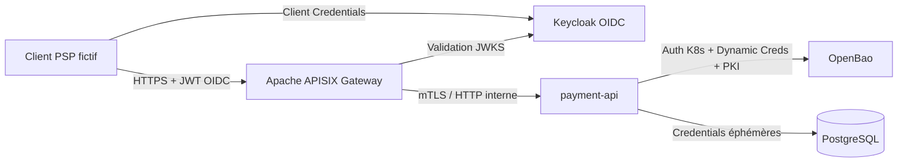

# Zero-Trust Payment API Lab

> **Déployer, sécuriser et valider une API de paiement instantané sur Kubernetes — zéro secret statique, identité fédérée et isolement réseau strict.**

| Attribut | Valeur |
| :--- | :--- |
| **Stack** | Kubernetes (`kind` ou `k3s`), OpenBao, Keycloak, Apache APISIX, PostgreSQL |
| **Durée estimée** | 60 à 90 minutes (déploiement + validation + challenge *Break & Fix*) |
| **Niveau** | Intermédiaire à avancé (Kubernetes, DevSecOps, IAM/Secrets) |
| **Environnement** | 100 % local, données et transactions strictement synthétiques |

## Pourquoi ce lab ?

Dans une architecture de paiement ou bancaire, exposer une API ne suffit pas : il faut prouver qu'aucun identifiant de base de données n'est stocké en clair, que chaque appelant (PSP) est authentifié et limité à ses scopes, et qu'une compromission latérale dans le cluster reste bloquée par le réseau.

Ce lab reproduit un cas d'usage concret de **transfert instantané inter-PSP** (`POST /v1/transfers`) avec une approche **Zero Static Secrets** pilotée par **OpenBao** et une validation automatisée de bout en bout.

## Quickstart

Prérequis minimums sur ta machine Linux (Ubuntu) : `docker`, `kubectl`, `helm`, `jq`, `curl` et `kind` (ou `k3s`).

```bash
git clone <repo-url> zero-trust-payment-api-lab
cd zero-trust-payment-api-lab

# 1. Provisionner le cluster local et déployer toute la stack
make up

# 2. Exécuter la suite de validation automatisée (scorecard sur 100 points)
make verify

# 3. Nettoyer complètement l'environnement
make down
```

## Architecture

Le trafic suit un chemin strictement contrôlé, sans contournement possible :



### Rôle des composants

| Composant | Namespace | Responsabilité |
| :--- | :--- | :--- |
| **Apache APISIX** | `edge` | Terminaison TLS, validation JWT (JWKS Keycloak), vérification des scopes, rate-limiting par PSP |
| **Keycloak** | `identity` | Realm `payments-sandbox`, clients OIDC (`psp-alpha`, `psp-beta`), scopes `payments:write` et `payments:read` |
| **OpenBao** | `secrets` | Auth Kubernetes native, moteur `database` (credentials PostgreSQL à TTL court), moteur `pki` (certificats TLS internes) |
| **payment-api** | `payments` | Service léger exposant `POST /v1/transfers` et `GET /v1/transfers/{id}` avec `Idempotency-Key` et audit log |
| **PostgreSQL** | `payments` | Stockage transactionnel isolé, accessible uniquement par `payment-api` et OpenBao |

## Structure du dépôt

Convention inspirée des dépôts cloud-native (noms explicites en `kebab-case`, zéro fichier redondant, point d'entrée unique via `Makefile`) :

```text
zero-trust-payment-api-lab/
├── Makefile                        # Commandes standards : up, verify, chaos, down
├── README.md                       # Ce guide
├── docs/
│   ├── architecture.md             # Détail des flux réseau, mTLS et politiques OpenBao
│   ├── chaos-scenarios.md          # Guides de diagnostic pour le mode Break & Fix
│   └── scorecard-template.md       # Modèle de rapport d'exécution (preuves)
├── k8s/
│   ├── clusters/
│   │   └── kind-config.yaml        # Configuration du cluster local
│   ├── platform/
│   │   ├── openbao/                # Values Helm, policies HCL et scripts d'init moteurs
│   │   ├── keycloak/               # Values Helm + export JSON du realm sandbox
│   │   └── apisix/                 # Values Helm + routes/plugins déclaratifs
│   ├── workloads/
│   │   ├── postgres/               # StatefulSet PostgreSQL durci
│   │   └── payment-api/            # Deployment non-root, ServiceAccount, annotations OpenBao Agent
│   └── security/
│       ├── network-policies/       # Default-deny + règles explicites inter-namespaces
│       └── pod-security/           # Labels Pod Security Standards (restricted)
├── services/
│   └── payment-api/                # Code source de la mini-API + Dockerfile distroless + tests
└── scripts/
    ├── bootstrap.sh                # Déploiement idempotent complet
    ├── verify.sh                   # Suite automatisée CHECK-01 à CHECK-08 + calcul du score
    ├── chaos.sh                    # Injection de pannes réalistes (Break & Fix)
    └── teardown.sh                 # Suppression propre du cluster et des volumes
```

## Parcours du lab

### 1. Bootstrap de la plateforme
Lancer `make up` pour créer le cluster local, installer OpenBao, Keycloak, Apache APISIX et PostgreSQL, puis appliquer les `NetworkPolicy` par défaut (`default-deny-all`).

### 2. Zéro secret statique avec OpenBao
* Activer la méthode d'authentification `kubernetes` dans OpenBao.
* Configurer le moteur `database` sur PostgreSQL avec un rôle `payment-api-rw` (TTL par défaut `5m`, TTL max `15m`).
* Configurer le moteur `pki` pour délivrer des certificats internes à courte durée de vie.
* Injecter les credentials dynamiques dans le pod `payment-api` via l'**OpenBao Agent Injector** (montés uniquement en mémoire via `tmpfs`, jamais dans un `Secret` Kubernetes statique ni dans Git).

### 3. Protection OIDC & Gateway (Keycloak + APISIX)
* Importer le realm `payments-sandbox` avec deux clients fictifs : `psp-alpha` (`payments:write`, `payments:read`) et `psp-beta` (`payments:read` uniquement).
* Déclarer les routes APISIX avec validation JWT sur le endpoint JWKS de Keycloak et rate-limiting par `client_id`.

### 4. Vérification automatisée
Lancer `make verify` pour exécuter l'ensemble des assertions fonctionnelles et sécurité, puis inspecter le rapport généré.

### 5. Mode « Break & Fix » (optionnel)
Lancer `make chaos SCENARIO=1` (ou `2`, `3`) pour injecter une panne réaliste et diagnostiquer le problème comme en astreinte SRE :
* **Scénario 1 :** une `NetworkPolicy` bloque la résolution ou l'accès JWKS entre APISIX et Keycloak.
* **Scénario 2 :** le rôle OpenBao `payment-api-rw` perd ses droits de renouvellement de bail PostgreSQL.
* **Scénario 3 :** un pod non autorisé tente d'accéder directement à `payment-api` ou PostgreSQL en contournant la gateway.

## Comment mesurer le succès du lab

Un lab réussi ne se mesure pas au fait que les pods soient `Running`, mais à **des preuves vérifiables et reproductibles** sur 4 axes : **Fonctionnel**, **Identité & API**, **Secrets Dynamiques (OpenBao)** et **Hardening Kubernetes**.

### Grille de notation automatisée (`make verify` — 100 points)

| ID | Catégorie | Ce qui est vérifié automatiquement | Résultat attendu | Points |
| :--- | :--- | :--- | :--- | :---: |
| `CHECK-01` | **Zéro secret statique** | Scan des manifestes et du pod `payment-api` (`env`, `Secret`) | Aucun mot de passe DB en clair dans Git ou les `env` du conteneur | 15 |
| `CHECK-02` | **Secrets dynamiques OpenBao** | Lecture du bail actif OpenBao + test de révocation/rotation | Nouveau rôle PostgreSQL généré et rechargé sans redéploiement manuel | 20 |
| `CHECK-03` | **AuthN (Keycloak + APISIX)** | Appel `POST /v1/transfers` sans token ou avec JWT invalide | Rejet systématique en `HTTP 401` | 10 |
| `CHECK-04` | **AuthZ (Scopes OIDC)** | Appel `POST /v1/transfers` avec le token `psp-beta` (`read` only) | Rejet systématique en `HTTP 403` | 10 |
| `CHECK-05` | **Rate-Limiting** | Rafale de requêtes au-delà du quota configuré sur `psp-alpha` | Réponse `HTTP 429 Too Many Requests` | 10 |
| `CHECK-06` | **Fonctionnel & Idempotence** | `POST /v1/transfers` valide + rejeu avec même `Idempotency-Key` | `201 Created` puis `200 OK` sans double débit en base | 15 |
| `CHECK-07` | **Isolement réseau** | Pod sonde dans un namespace tiers vers `payment-api` et PostgreSQL | Connexions bloquées (timeout / drop par `NetworkPolicy`) | 10 |
| `CHECK-08` | **Hardening Pod** | Inspection `securityContext` de `payment-api` | `runAsNonRoot: true`, `readOnlyRootFilesystem: true`, `allowPrivilegeEscalation: false` | 10 |

### Seuils de validation

* **Score >= 90 / 100 avec `CHECK-01`, `CHECK-02` et `CHECK-07` obligatoirement au vert :** lab validé (niveau production-ready sur le périmètre sandbox).
* **Score entre 70 et 89 / 100 :** lab fonctionnel mais lacunes de sécurité à corriger avant validation.
* **Score < 70 / 100 ou échec sur `CHECK-01` / `CHECK-02` :** échec (présence de secrets statiques ou rupture de la chaîne OpenBao).
* **Bonus « SRE / CKS » :** résoudre les 3 scénarios `make chaos` en moins de 30 minutes et repasser `make verify` à `100 / 100`.

### Preuves attendues (pour portfolio ou atelier)
En fin de session, `scripts/verify.sh` exporte un résumé horodaté (statut des 8 checks, score final, versions des composants et preuve de rotation de bail OpenBao) prêt à être archivé ou partagé lors d'une démo technique.

## Sécurité et limites

Ce laboratoire est conçu **exclusivement à des fins d'apprentissage et de démonstration** :
* Toutes les transactions, comptes et identifiants PSP sont **100 % synthétiques**.
* Ne jamais réutiliser les certificats de test, le realm Keycloak sandbox ou la configuration OpenBao locale sur un environnement de production.
* Ce lab ne constitue pas une certification réglementaire ni une conformité PCI DSS.
